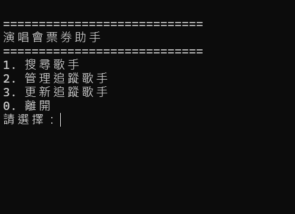

這是在終端機裡執行的程式，還沒有網頁版，自己的第一個小作品以後有時間再更新。

## 它能做什麼

- **搜尋演唱會**：輸入歌手名稱，從多個 KKTIX 活動來源找出相關的演唱會資訊。
- **追蹤歌手**：新增、查看、刪除想追蹤的歌手。
- **自動更新**：依照追蹤名單搜尋最新的活動，更新到資料庫。
- **資料庫儲存**：演唱會的歌手、活動名稱、售票平台、售票時間、活動日期、地點、網址和狀態，都存在 SQLite 資料庫裡，之後可以再查詢。

## 怎麼做的

用 Requests 抓取 KKTIX 的活動資料，再用 BeautifulSoup 和 XML 解析整理出需要的欄位。資料庫有兩張表：`concert` 存演唱會資訊，`tracked_artist` 存追蹤的歌手；執行更新時，程式會依照追蹤名單一個一個去搜尋。

## 學到什麼

網頁資料擷取、SQLite 資料庫操作、函式設計與模組化，以及把多個來源的資料整合在一起。

## 接下來想做

支援更多售票平台、自動通知、網頁版介面和手機版。
